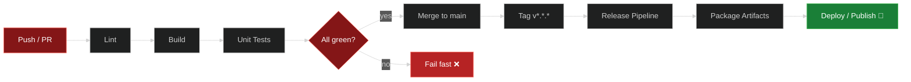

<p align="center">
  
</p>

<p align="center">
  
</p>

<p align="center">
  <a href="https://github.com/Brasilius/OU-CHAOS-Mono-Repo/actions/workflows/ci.yml"></a>
  <a href="https://github.com/Brasilius/OU-CHAOS-Mono-Repo/actions/workflows/release.yml"></a>
  
  
  
  
  
  
</p>

> _"Creating the time to change the outcome."_
>
> A senior capstone collaboration between the **University of Oklahoma** and
> [**CHAOS Industries**](https://www.chaosinc.com) — turning mission
> engineering into defense-grade systems, built by students.

---

## 📑 Table of Contents

- [About](#-about)
- [Repository Structure](#-repository-structure)
- [Getting Started](#-getting-started)
- [CI/CD Pipelines](#-cicd-pipelines)
- [Roadmap](#-roadmap)
- [Contributors](#-contributors)
- [Acknowledgments](#-acknowledgments)

---

## 🎯 About


<!-- Describe the project mission, scope, and capstone deliverables here. -->

This monorepo hosts the shared codebase for the **OU × CHAOS Industries
collaboration capstone**: a year-long engineering partnership pairing OU
students with CHAOS Industries mentors to deliver real-world defense
technology.

| | |
|---|---|
| **Institution** | University of Oklahoma — Norman, OK |
| **Industry Partner** | [CHAOS Industries](https://www.chaosinc.com) — defense technology |
| **Duration** | 2025 – 2026 academic year |
| **Team** | _add team members here_ |

## 🗂 Repository Structure


```
OU-CHAOS-Mono-Repo/
├── .github/
│   └── workflows/        # CI/CD pipelines (ci.yml, release.yml)
├── assets/               # Branding, banners & animations
├── apps/                 # Deployable applications        (coming soon)
├── packages/             # Shared libraries               (coming soon)
├── docs/                 # Project documentation          (coming soon)
└── README.md
```

## 🚀 Getting Started


<!-- Add real setup instructions as the toolchain lands. -->

```bash
# Clone the monorepo
git clone https://github.com/Brasilius/OU-CHAOS-Mono-Repo.git
cd OU-CHAOS-Mono-Repo

# Install dependencies (placeholder)
# npm install

# Run the test suite (placeholder)
# npm test
```

## ⚙️ CI/CD Pipelines


Every push and pull request runs through the pipelines below. Status is
reported in the badges at the top of this README and on every commit.



| Workflow | File | Trigger | Purpose |
|---|---|---|---|
| **CI** | [`ci.yml`](.github/workflows/ci.yml) | push / PR to `main` | Lint, build, test |
| **Release** | [`release.yml`](.github/workflows/release.yml) | version tags `v*` | Package & publish |

## 🗺 Roadmap


- [x] Stand up the monorepo
- [x] Wire up CI/CD pipelines
- [ ] Define project scope with CHAOS mentors
- [ ] First prototype milestone
- [ ] Mid-year demo
- [ ] Capstone showcase 🎓

## 👥 Contributors


<!-- Swap this table for an all-contributors widget once the team is set. -->

| Role | Name |
|---|---|
| Faculty Advisor | _TBD_ |
| Industry Mentor (CHAOS) | _TBD_ |
| Student Engineer | _add yourself!_ |

<a href="https://github.com/Brasilius/OU-CHAOS-Mono-Repo/graphs/contributors">
  
</a>

## 🙏 Acknowledgments


Sincere thanks to the engineers at [CHAOS Industries](https://www.chaosinc.com)
and the faculty and staff of the [University of Oklahoma](https://www.ou.edu)
for making this capstone possible.

---

<p align="center">
  
</p>

<p align="center">
  <b>BOOMER</b> · <i>sooner</i> 🚀
</p>

<p align="center">
  <a href="https://www.ou.edu"></a>
  &nbsp;
  <a href="https://www.chaosinc.com"></a>
</p>

<p align="center">
  <sub>Capstone • 2025–2026 • Norman, OK</sub>
</p>
